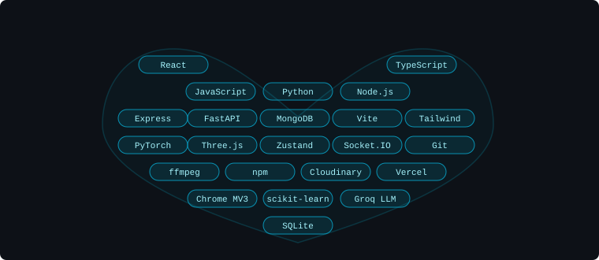

<!-- ═══════════════════════════════════════════════════════════════ -->
<!--  HERO — dark teal/near-black, no purple                       -->
<!-- ═══════════════════════════════════════════════════════════════ -->

 

  
  &nbsp;
  
  &nbsp;
  
  &nbsp;
  

<!-- ═══════════════════════════════════════════════════════════════ -->
<!--  ABOUT                                                         -->
<!-- ═══════════════════════════════════════════════════════════════ -->

## // about

I build developer tools, browser extensions, and full-stack systems — the kind of software that coordinates how resources load, detects phishing pages by fusing four ML signals, or quietly decides which browser tab should stop yelling. Mostly TypeScript and Python, occasionally regret. If it's a hard problem at the intersection of performance and AI, I'm already thinking about it.

<!-- ═══════════════════════════════════════════════════════════════ -->
<!--  TECH STACK — heart-shaped badge arrangement                   -->
<!-- ═══════════════════════════════════════════════════════════════ -->

## // stack

<!-- ═══════════════════════════════════════════════════════════════ -->
<!--  FEATURED PROJECTS                                             -->
<!-- ═══════════════════════════════════════════════════════════════ -->

## // projects

<table width="100%">
<tr>
<td width="50%" valign="top">

### 🛡️ Phish360

Multimodal phishing detector that fuses URL lexical patterns, DOM structure, page text, and a live screenshot through a late-fusion ML ensemble — four independent signals, one verdict, zero blacklist dependency.

`React` `TypeScript` `FastAPI` `PyTorch` `Chrome MV3`

</td>
<td width="50%" valign="top">

### âš¡ ReactFastLoad

npm library that controls *when* React resources load, not just whether they do. Five priority levels, shared `IntersectionObserver` viewport preloading, concurrency cap, and connection-aware back-pressure — no fetch interception.

`React ≥17` `TypeScript` `ESM + CJS`

</td>
</tr>

<tr><td colspan="2"> </td></tr>

<tr>
<td width="50%" valign="top">

### 🎚️ Hush

Chrome extension with per-tab volume sliders and intelligent audio conflict resolution. Intercepts both HTML5 media and Web Audio API contexts. Organizes tabs into Chrome Tab Groups. Four acoustic scenes, drag-and-drop reclassification.

> Chrome Web Store: **Pending Review** — load unpacked for local use.

`React 19` `TypeScript` `Vite` `Chrome MV3`

</td>
<td width="50%" valign="top">

### 🎵 Musify

Music platform with a real server-side DSP pipeline: RMS energy, FFT spectral centroid, onset-autocorrelation tempo, over a single 8 kHz PCM pass. Cosine-similarity recommendations, Markov-graph prefetching. ReactFastLoad cut the initial bundle by ~29.6%.

`React 19` `Express 5` `MongoDB` `ffmpeg` `Groq`

</td>
</tr>
</table>

<b>+ ProjectU — private real-time app for two</b>

 

Real-time private web app: live Socket.IO chat, synchronized music with playback lock, mood board, shared links. Secured with cryptographic pairing codes and HTTP-only JWT. ReactFastLoad cut initial bundle ~49% (307 kB → 156 kB).

&nbsp; `React 18` `Socket.IO` `Express 5` `MongoDB`

<!-- ═══════════════════════════════════════════════════════════════ -->
<!--  GITHUB ACTIVITY                                               -->
<!-- ═══════════════════════════════════════════════════════════════ -->

## // activity

&nbsp;&nbsp;

<!--
  CONTRIBUTION SNAKE — add this workflow to enable:

  File: .github/workflows/snake.yml
  ───────────────────────────────
  name: Generate Snake
  on:
    schedule: [{ cron: "0 0 * * *" }]
    workflow_dispatch:
  permissions: { contents: write }
  jobs:
    build:
      runs-on: ubuntu-latest
      steps:
        - uses: Platane/snk@v3
          with:
            github_user_name: abhishek-kumar-pundir
            outputs: |
              dist/github-contribution-grid-snake-dark.svg?palette=github-dark
        - uses: crazy-max/ghaction-github-pages@v4
          with:
            target_branch: output
            build_dir: dist
          env:
            GITHUB_TOKEN: ${{ secrets.GITHUB_TOKEN }}

  Then run the workflow once from the Actions tab and uncomment below:
  
-->

<!-- ═══════════════════════════════════════════════════════════════ -->
<!--  CONTACT                                                       -->
<!-- ═══════════════════════════════════════════════════════════════ -->

## // contact

&nbsp;

&nbsp;

&nbsp;

