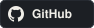
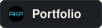
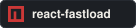

<h1 align="center">
  
</h1>

  <strong>Full-Stack Developer &bull; Systems & Web Audio &bull; npm Author</strong>

  
  &nbsp;
  
  &nbsp;
  
  &nbsp;
  

### About Me

- 🎓 CSE student passionate about learning and building things that matter.
- 🚀 Always exploring new ideas and pushing beyond what I already know.
- 🧠 Curious by nature, driven by challenges, and obsessed with continuous improvement.
- 🌱 Focused on growing as an engineer and becoming better every day.

### Tech Stack

 &nbsp;
 &nbsp;
 &nbsp;
 &nbsp;
 &nbsp;

 
 &nbsp;
 &nbsp;
 &nbsp;
 &nbsp;
 &nbsp;

 
 &nbsp;
 &nbsp;
 &nbsp;
 &nbsp;
 &nbsp;

 
 &nbsp;
 &nbsp;
 &nbsp;
 &nbsp;
 &nbsp;

 
 &nbsp;
 &nbsp;
 &nbsp;
 &nbsp;

 
 &nbsp;
 &nbsp;
 &nbsp;
 &nbsp;

### Featured Projects

<table width="100%">
<tr>
<td width="50%" valign="top">

###  Phish360

Multimodal phishing detector that fuses URL lexical patterns, DOM structure, page text, and a live screenshot through a late-fusion ML ensemble — four independent signals, one verdict, zero blacklist dependency.

  
  
  
  
  

</td>
<td width="50%" valign="top">

###  ReactFastLoad

npm library that controls *when* React resources load, not just whether they do. Five priority levels, shared `IntersectionObserver` viewport preloading, concurrency cap, and connection-aware back-pressure — no fetch interception.

  
  
  

</td>
</tr>

<tr>
<td width="50%" valign="top">

###  Hush

Chrome extension with per-tab volume sliders and intelligent audio conflict resolution. Intercepts both HTML5 media and Web Audio API contexts. Organizes tabs into Chrome Tab Groups. Four acoustic scenes, drag-and-drop reclassification.

> Chrome Web Store: **Pending Review** — load unpacked for local use.

  
  
  
  

</td>
<td width="50%" valign="top">

###  Musify

Music platform with a real server-side DSP pipeline: RMS energy, FFT spectral centroid, onset-autocorrelation tempo, over a single 8 kHz PCM pass. Cosine-similarity recommendations, Markov-graph prefetching. ReactFastLoad cut initial bundle ~29.6%.

  
  
  
  
  

</td>
</tr>
</table>

<b>+ ProjectU — private real-time app for two</b>

 

Real-time private web app: live Socket.IO chat, synchronized music with playback lock, mood board, shared links. Secured with cryptographic pairing codes and HTTP-only JWT. ReactFastLoad cut initial bundle ~49% (307 kB → 156 kB).

  
  
  
  

### GitHub Activity

&nbsp;&nbsp;

<!--
  CONTRIBUTION SNAKE — add this workflow to enable:

  File: .github/workflows/snake.yml
  ───────────────────────────────
  name: Generate Snake
  on:
    schedule: [{ cron: "0 0 * * *" }]
    workflow_dispatch:
  permissions: { contents: write }
  jobs:
    build:
      runs-on: ubuntu-latest
      steps:
        - uses: Platane/snk@v3
          with:
            github_user_name: abhishek-kumar-pundir
            outputs: |
              dist/github-contribution-grid-snake-dark.svg?palette=github-dark
        - uses: crazy-max/ghaction-github-pages@v4
          with:
            target_branch: output
            build_dir: dist
          env:
            GITHUB_TOKEN: ${{ secrets.GITHUB_TOKEN }}

  Then run the workflow once from the Actions tab and uncomment below:
  
-->

### Let's Connect

&nbsp;&nbsp;

&nbsp;&nbsp;

&nbsp;&nbsp;

